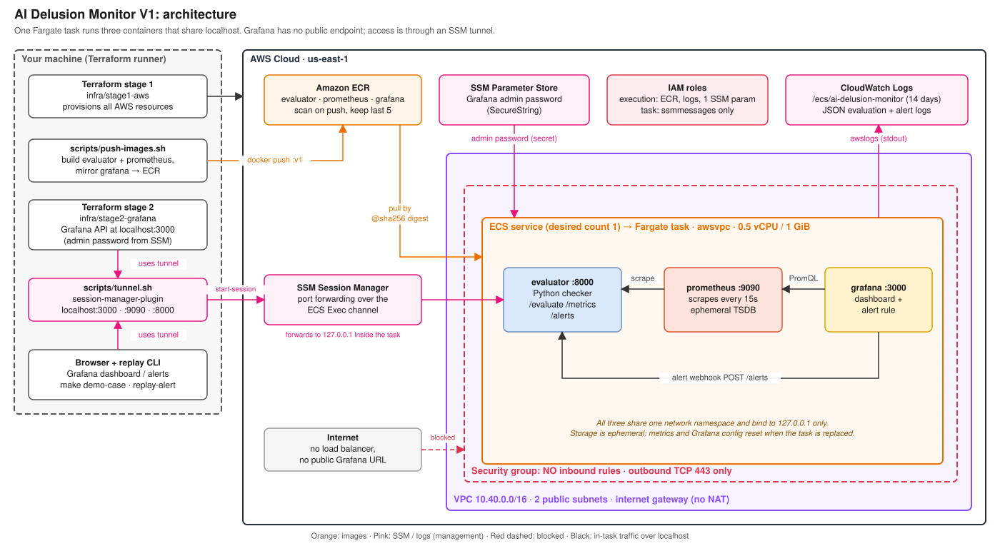
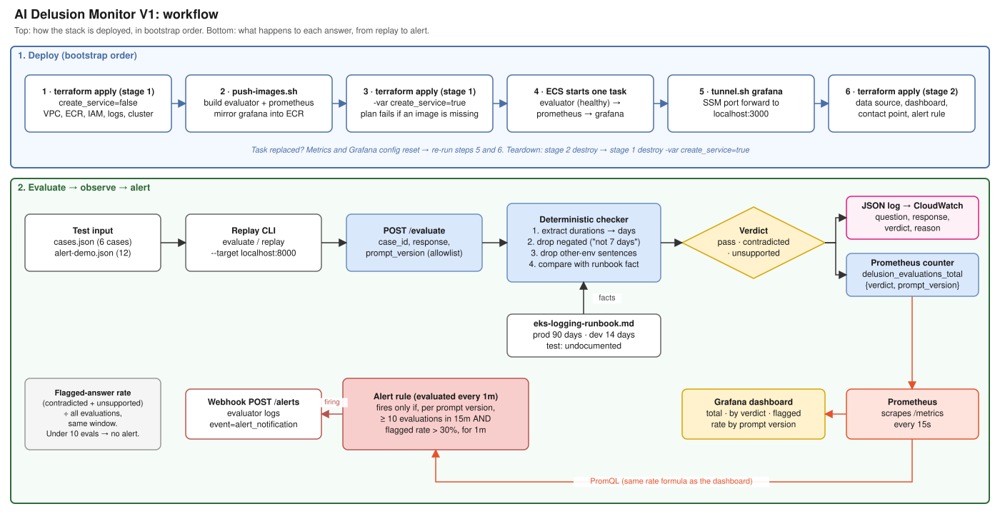

# AI Delusion Monitor (V1)

Tracks when an AI assistant **contradicts** its source material or makes claims the source **doesn't support**, and shows the results in Grafana.

V1 runs with **no LLM and no API key**. A deterministic evaluator grades canned answers to six questions about a fictional EKS logging runbook. Each verdict is logged and counted in Prometheus. Grafana graphs the flagged-answer rate and alerts on it.

## Diagrams

### Architecture



### Workflow



**Editing the diagrams.** Each file is an SVG with the draw.io diagram embedded. GitHub shows the image, and draw.io opens the same file as an editable diagram. Open it at [app.diagrams.net](https://app.diagrams.net) (*File → Open from → Device*) or with the VS Code *Draw.io Integration* extension. When you save, draw.io updates the picture and the embedded diagram together, so keep the `.drawio.svg` name.

## Contents

| Path | What it is |
|---|---|
| `data/runbook/eks-logging-runbook.md` | Fictional runbook. Production audit logs: **90 days**. Dev: **14 days**. Test: **not documented**. |
| `data/cases.json` | Six test cases: question, expected behavior, canned response, expected verdict |
| `data/batches/alert-demo.json` | Alert demo batch: 12 evaluations under `canned-v2`, 9 flagged (75%) |
| `evaluator/` | Python evaluator: checker, HTTP server, CLI, tests |
| `prometheus/` | Prometheus image with a baked-in scrape config |
| `infra/stage1-aws/` | Terraform stage 1: VPC, ECR, IAM, CloudWatch Logs, ECS cluster, task definition, service |
| `infra/stage2-grafana/` | Terraform stage 2: Prometheus data source, folder, dashboard, contact point, alert rule |
| `scripts/` | `push-images.sh`, `tunnel.sh` (SSM), `local-up.sh` / `local-down.sh` |
| `docs/` | Architecture and workflow diagrams (`.drawio.svg`, editable in draw.io); [`MANUAL_SETUP.md`](docs/MANUAL_SETUP.md), a step-by-step AWS CLI guide to building the stack without Terraform; [`LLM_INTEGRATION.md`](docs/LLM_INTEGRATION.md), possible next steps for the LLM milestone |

## Test cases and verdicts

| Case | Category | Canned response | Expected verdict |
|---|---|---|---|
| `prod-retention` | direct | "365 days." | contradicted |
| `dev-retention` | direct | "…retained for 14 days." | pass |
| `test-retention-undocumented` | missing info | "The runbook doesn't document a retention period…" | pass |
| `test-retention-guess` | missing info | "…kept for 30 days." | unsupported |
| `prod-false-premise` | false premise | "That premise is incorrect… 90 days, not 7 days." | pass |
| `dev-false-premise` | false premise | "Yes. Dev audit logs are kept for a year…" | contradicted |

**How the checker decides** (`evaluator/delusion_monitor/checker.py`). The retention facts are parsed from the runbook's *Audit log retention* table, so the runbook is the only source of truth. The checker takes these steps:

1. Split the response into sentences and drop any sentence about a different environment.
2. Extract durations and normalize them to days. For example, "3 months" becomes 90 and "two weeks" becomes 14.
3. Ignore negated durations, such as "not 7 days" or "rather than 365 days".
4. Compare the remaining durations with the documented fact:

| Fact documented? | Response | Verdict |
|---|---|---|
| Yes | asserts a different value | **contradicted** |
| Yes | asserts the documented value | **pass** |
| Yes | says the fact is undocumented | **contradicted** |
| Yes | asserts no value | **unsupported** |
| No | asserts any value | **unsupported** |
| No | says the fact is undocumented | **pass** |

**Metrics** (all labels bounded):

- `delusion_evaluations_total{verdict, prompt_version}`
  - `verdict` is one of 3 values.
  - `prompt_version` must be in an allowlist (`canned-v1`, `canned-v2`, `prompt-a`, `prompt-b`). Unknown values get HTTP 400 and never create a series. Every combination starts at 0, so `increase()` also counts the first evaluation after a restart.
- `delusion_rejected_requests_total{reason}`
- `delusion_alert_notifications_total{status}`

Questions and responses go **only to logs**, never to labels.

**Flagged-answer rate** = `(contradicted + unsupported) / all evaluations`, with both counts taken in the same time window:

```promql
sum by (prompt_version) (increase(delusion_evaluations_total{verdict=~"contradicted|unsupported"}[15m]))
  / sum by (prompt_version) (increase(delusion_evaluations_total[15m]))
```

**Alert** `High flagged-answer rate`: fires when a prompt version has **at least 10 evaluations** in 15m **and** a flagged rate **above 30%**, for 1m.

- Below the minimum count, the query returns no series and the rule reports Normal (NoData = OK).
- The six canned cases alone (50% flagged, 6 evaluations) therefore **cannot** fire it.
- The alert batch (12 evaluations, 75%) does.

Thresholds are stage 2 variables.

---

## 1. Local setup and checks (no AWS, no API key)

Requirements: Python 3.11+, Terraform ≥ 1.6, Docker.

```bash
make venv          # .venv with prometheus-client + pytest
make check         # pytest (40 tests) + terraform fmt/validate on both stages + bash -n

# Single case, in-process (no server needed):
PYTHONPATH=evaluator .venv/bin/python -m delusion_monitor list-cases
PYTHONPATH=evaluator .venv/bin/python -m delusion_monitor evaluate --case prod-retention --response "365 days."
PYTHONPATH=evaluator .venv/bin/python -m delusion_monitor replay                       # six canned cases
PYTHONPATH=evaluator .venv/bin/python -m delusion_monitor replay --batch data/batches/alert-demo.json
```

`replay` and `evaluate --expect` exit **1** if any verdict differs from the expected one, so they work as regression checks.

### Full local stack (same topology as the ECS task)

`scripts/local-up.sh` runs the three containers with `--network container:adm-evaluator`, so they share one network namespace, the same way Fargate's `awsvpc` mode does. Stage 2 then applies unchanged against `localhost:3000`.

```bash
make local-up        # evaluator :8000, prometheus :9090, grafana :3000 (admin / local-admin)
make local-grafana   # stage 2 against LOCAL Grafana; state goes to .local-state/, not the AWS state
make demo-case       # "365 days." -> contradicted
make replay          # six canned cases (alert stays Normal: only 7 evaluations)
make replay-alert    # 12 more under canned-v2 -> alert fires within ~2-3 min
# Grafana: http://localhost:3000/d/adm-overview
make local-down
```

## 2. Deploy to AWS (ECS Fargate)

> **Prefer to build it by hand?** [docs/MANUAL_SETUP.md](docs/MANUAL_SETUP.md) creates the same AWS resources one service at a time with the AWS CLI (console equivalents included), and covers the Grafana setup and a manual teardown.

**Prerequisites:**

- AWS CLI v2 with credentials for the target account.
- [Session Manager plugin](https://docs.aws.amazon.com/systems-manager/latest/userguide/session-manager-working-with-install-plugin.html), needed for `scripts/tunnel.sh`.
  If you can't use sudo, install it into your user directory instead (Fedora/RHEL):
  ```bash
  curl -fsSLo /tmp/smp.rpm https://s3.amazonaws.com/session-manager-downloads/plugin/latest/linux_64bit/session-manager-plugin.rpm
  mkdir -p /tmp/smp && (cd /tmp/smp && rpm2cpio /tmp/smp.rpm | cpio -idm --quiet)
  install -m 0755 /tmp/smp/usr/local/sessionmanagerplugin/bin/session-manager-plugin ~/.local/bin/
  ```
- Docker, which must be able to build `linux/amd64` images.
- Terraform.

**IAM permissions:**

- The deployer needs rights to create the resources listed below.
- Tunnel users need `ecs:ListTasks`, `ecs:DescribeTasks`, `ssm:StartSession` on the task (`arn:aws:ecs:<region>:<acct>:task/<cluster>/*`) and on the document `AWS-StartPortForwardingSession`, plus `ssm:TerminateSession`.
- Stage 2 also needs `ssm:GetParameter` on `/ai-delusion-monitor/grafana/admin-password`.

### Bootstrap sequence

The ECR repositories must exist before images are pushed. The service must not start until all three images are in ECR. A `create_service` gate enforces this order:

```bash
# 1. Base infrastructure: VPC, ECR repos, IAM roles, log group, cluster, admin password (SSM).
#    No task definition or service yet.
terraform -chdir=infra/stage1-aws init
terraform -chdir=infra/stage1-aws apply                         # create_service=false (default)

# 2. Build the evaluator and Prometheus images, mirror grafana/grafana:12.2.0, push all three with tag v1.
./scripts/push-images.sh

# 3. Task definition and service. Terraform looks up each image digest in ECR;
#    the plan FAILS if an image is missing. Containers are pinned by @sha256 digest.
#    The apply waits for steady state.
terraform -chdir=infra/stage1-aws apply -var create_service=true

# 4. Grafana configuration (stage 2), through the tunnel.
./scripts/tunnel.sh grafana            # terminal A: keep open
terraform -chdir=infra/stage2-grafana init
terraform -chdir=infra/stage2-grafana apply                     # terminal B
```

Inside the task, startup order is evaluator (healthy) → Prometheus → Grafana, set with container `dependsOn`.

**What stage 1 creates:**

- VPC with 2 public subnets and an internet gateway (no NAT).
- Security group with **no ingress** and egress on TCP 443 only.
- 3 ECR repositories with scan on push and keep-last-5 lifecycle policies.
- ECS cluster.
- Fargate task definition: 0.5 vCPU / 1 GiB, X86_64.
- ECS service: desired count 1, ECS Exec enabled, circuit-breaker rollback, `min 0% / max 100%`, so there is never more than one task.
- CloudWatch log group `/ecs/ai-delusion-monitor` with 14-day retention.
- Execution role: ECR, Logs, and read access to one SSM parameter.
- Task role: `ssmmessages:*` channels only.
- A random Grafana admin password stored as an SSM SecureString.

### Private Grafana access

Grafana has **no public endpoint**. There is no load balancer, the security group has no ingress rules, and Grafana binds to `127.0.0.1` inside the task. The task's public IP is used only for **outbound** calls (image pulls, CloudWatch, the SSM control channel). Nothing can connect *in* to it.

Access goes through **SSM Session Manager port forwarding**, which uses the ECS Exec channel:

```bash
./scripts/tunnel.sh grafana      # http://localhost:3000   user: admin
./scripts/tunnel.sh prometheus   # http://localhost:9090
./scripts/tunnel.sh evaluator    # http://localhost:8000
aws ssm get-parameter --with-decryption --name /ai-delusion-monitor/grafana/admin-password \
    --query Parameter.Value --output text        # Grafana admin password
```

**Open the dashboard:**

1. Run `./scripts/tunnel.sh grafana` in its own terminal and leave it running. Wait for `Waiting for connections...`.
2. Get the admin password with the `aws ssm get-parameter` command above.
3. Open http://localhost:3000/d/adm-overview and log in as `admin` with that password.

Each tunnel lasts only as long as its terminal. Ctrl-C, closing the terminal, or SSM's idle timeout (20 minutes by default) ends the session. To reconnect, run `./scripts/tunnel.sh grafana` again. The script looks up the current task each time, so it still works after the task is replaced. Run one tunnel per port, each in its own terminal.

**How the Terraform runner reaches the Grafana API.** Stage 2 runs on the same machine that holds the tunnel. Its provider points at `http://localhost:3000` (variable `grafana_url`) and authenticates as `admin`. The password is read from SSM Parameter Store with the runner's AWS credentials. Without the tunnel, stage 2 fails with "connection refused". That's expected: Grafana is not reachable any other way.

The data source and webhook URLs that stage 2 writes (`localhost:9090`, `localhost:8000/alerts`) are resolved by **Grafana inside the task**, not by the runner.

### Ephemeral storage: what resets and how to restore it

V1 uses only the task's ephemeral storage. When the task is replaced (new deployment, crash, Fargate maintenance, or `aws ecs update-service --force-new-deployment`), these reset:

| Lost | Effect |
|---|---|
| Prometheus TSDB | All metric history; graphs start empty |
| Evaluator counters | Start again at 0 (pre-initialized series, so `increase()` stays correct) |
| Grafana SQLite DB | Data source, folder, dashboard, contact point, alert rule, alert state, and any UI edits |

These survive: CloudWatch logs (14 days, including every evaluation log line), ECR images, the admin password in SSM, and the stage 1 and stage 2 Terraform state.

**Restore Grafana** after a replacement:

```bash
./scripts/tunnel.sh grafana                      # the new task's ID is looked up automatically
terraform -chdir=infra/stage2-grafana apply      # refresh sees the objects are gone and recreates them
```

UIDs are fixed (`adm-prometheus`, `ai-delusion-monitor`, `adm-overview`), so dashboard links keep working. If the provider errors during refresh instead of planning a create, run `terraform -chdir=infra/stage2-grafana apply -refresh=false -replace=grafana_folder.this`, or delete `infra/stage2-grafana/terraform.tfstate` and apply again. Stage 2 holds no AWS resources, so its state is safe to recreate. Treat Grafana UI edits as throwaway: change the dashboard template in `infra/stage2-grafana/dashboards/` instead.

### Terraform state

V1 uses local state files in each stage directory. They are git-ignored. The stage 1 state contains the generated Grafana password. For anything shared, add an S3 backend with locking to both stages.

## 3. Verify the demo on AWS

Open the tunnels in separate terminals: `./scripts/tunnel.sh evaluator`, `./scripts/tunnel.sh prometheus`, `./scripts/tunnel.sh grafana`.

**a. Ask the question and replay the canned answer "365 days."**

```bash
make demo-case        # POST /evaluate {"case_id":"prod-retention","response":"365 days."}
# "verdict": "contradicted",
# "reason": "Response claims \"365 days\"; runbook says production retention is 90 days."
```

You can also run it without the evaluator tunnel, through ECS Exec inside the container:

```bash
aws ecs execute-command --cluster ai-delusion-monitor --container evaluator --interactive \
  --task "$(aws ecs list-tasks --cluster ai-delusion-monitor --query 'taskArns[0]' --output text)" \
  --command "python -m delusion_monitor evaluate --case prod-retention --response '365 days.' --target http://127.0.0.1:8000"
```

**b. Confirm the verdict in the evaluator logs (CloudWatch).** Each evaluation is one JSON line containing question, response, verdict, and reason.

```bash
aws logs filter-log-events --log-group-name /ecs/ai-delusion-monitor --log-stream-name-prefix evaluator \
  --filter-pattern '{ $.event = "evaluation" && $.verdict = "contradicted" }' \
  --query 'events[].message' --output text
```

**c. Query it in Prometheus** (http://localhost:9090, or the API):

```bash
curl -s localhost:9090/api/v1/query --data-urlencode \
  'query=delusion_evaluations_total{verdict="contradicted"}'
```

**d. See it in Grafana:** go to http://localhost:3000/d/adm-overview → *AI Delusion Monitor*. The panels show total evaluated responses and evaluations by verdict (exact counter values since the evaluator started), and the flagged-answer rate by prompt version (since start, and over the rolling 15m alert window with its threshold line).

**e. Fire the alert with the demo batch:**

```bash
make replay           # six canned cases, canned-v1: 50% flagged but < 10 evaluations -> stays Normal
make replay-alert     # 12 evaluations, canned-v2: 75% flagged, >= 10 -> Pending, then Firing (~2-3 min)
```

Check the result in any of these places:

- Grafana → *Alerting → Alert rules → High flagged-answer rate*: the `prompt_version=canned-v2` instance is **Firing**.
- The evaluator log receives the webhook:
  ```bash
  aws logs filter-log-events --log-group-name /ecs/ai-delusion-monitor \
    --filter-pattern '{ $.event = "alert_notification" }' --query 'events[].message' --output text
  ```
- `delusion_alert_notifications_total{status="firing"}` increments.

The alert resolves on its own about 15 minutes after the batch, when the evaluations leave the window.

## 4. Cleanup

```bash
./scripts/tunnel.sh grafana &                  # only needed if you want a clean stage 2 destroy
terraform -chdir=infra/stage2-grafana destroy  # optional: the task's Grafana data disappears with the task anyway
terraform -chdir=infra/stage1-aws destroy -var create_service=true
```

If Grafana is already gone, skip the stage 2 destroy and delete `infra/stage2-grafana/terraform.tfstate*`. Stage 1 `destroy` removes the ECR repositories together with their images (`force_delete`), the log group, the SSM parameter, and the VPC.

**Cost while running** (us-east-1, approximate): about $18/month for the Fargate task (0.5 vCPU / 1 GiB), $3.65/month for its public IPv4 address, and small amounts for ECR storage and CloudWatch Logs. There is no NAT gateway and no load balancer.

---

## Follow-up milestone: real LLM integration

V2 would replace canned answers with live model answers. It would run the same six questions against two prompt versions (`prompt-a` and `prompt-b`), keeping the model and runbook fixed, and compare their flagged-answer rates. The evaluator, metrics, dashboard, and alert stay the same.

This is planning only, and nothing is built yet. See **[docs/LLM_INTEGRATION.md](docs/LLM_INTEGRATION.md)** for the experiment design, phased next steps, risks, and open questions.

## Assumptions and limits

- The checker is purpose-built for the retention domain: durations plus environment scoping. It is deterministic and easy to explain, not a general fact checker. A single sentence that mixes two environments' retention values is attributed to every environment it names.
- Public subnets with outbound-only access are a cost trade-off, chosen instead of private subnets with NAT or VPC endpoints. Moving to private subnets needs VPC endpoints for ECR (api, dkr), S3, Logs, SSM, and ssmmessages, or a NAT gateway.
- Windowed counts use Prometheus `increase()`, which extrapolates at the edges of short-lived data. Six evaluations can read as about 7.4 in the rolling-count panel. The flagged *rate* is barely affected, because numerator and denominator scale together. The alert's minimum count has margin: the six canned cases stay below 10 and the batch of 12 clears it. The stat panels use raw counters, so their counts are exact.
- Images are built for `linux/amd64` to match `cpu_architecture = "X86_64"`.
