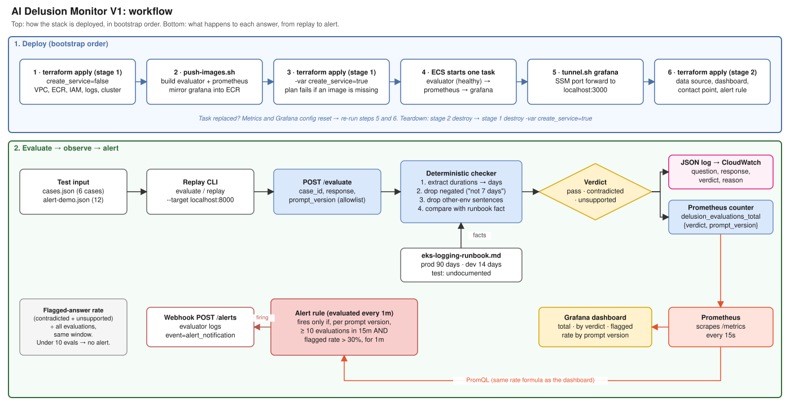

# Manual setup guide (AWS CLI, no Terraform)

This guide builds the same V1 stack as `infra/stage1-aws` and `infra/stage2-grafana`, one AWS service at a time. Use it to learn what Terraform creates for you, or to deploy where Terraform isn't available.

> **Use one method per stack.** Don't build by hand and then run `terraform apply` in the same account and region with the same names. Terraform would try to create resources that already exist and fail. To switch methods, tear the stack down first (see [Teardown](#12-teardown)).

### Architecture

Steps 1–9 create the AWS resources shown here: ECR, Parameter Store, IAM, CloudWatch Logs, the VPC and security group, and the ECS service with its task. SSM Session Manager is a managed AWS service; step 10 only uses it.


### Workflow



The top lane shows the Terraform path. It maps to this guide like this:

| Diagram step | Terraform path | This guide |
|---|---|---|
| 1 | Stage 1 apply (`create_service=false`) | Steps 1–6 |
| 2 | `push-images.sh` | Step 7 |
| 3 | Stage 1 apply (`create_service=true`) | Step 8 (task definition), Step 9 (service) |
| 4 | ECS starts the task | End of step 9 |
| 5 | `tunnel.sh grafana` | Step 10 |
| 6 | Stage 2 apply | Step 11 |

The bottom lane is the same however you deploy. It's what you verify after step 11.

**What you'll create:**

| # | Service | Resources |
|---|---|---|
| 1 | VPC | VPC, internet gateway, 2 public subnets, route table, security group (no inbound rules) |
| 2 | ECR | 3 repositories: `evaluator`, `prometheus`, `grafana` |
| 3 | SSM Parameter Store | Grafana admin password (SecureString) |
| 4 | IAM | Task execution role, task role |
| 5 | CloudWatch Logs | Log group `/ecs/ai-delusion-monitor` |
| 6 | ECS | Cluster |
| 7 | ECR (push) | Three container images |
| 8 | ECS | Task definition, pinned to image digests |
| 9 | ECS | Service (desired count 1, ECS Exec on) |
| 10 | SSM Session Manager | Port-forwarding tunnel to the private Grafana |
| 11 | Grafana | Data source, dashboard, contact point, alert rule |

**Cost while running:** about $22/month (Fargate 0.5 vCPU / 1 GiB, plus a public IPv4 address). Steps 1–6 cost almost nothing until the service starts in step 9.

---

## 0. Prerequisites and shell variables

You need:

- AWS CLI v2, configured with credentials that can create VPC, ECR, IAM, SSM, CloudWatch Logs, and ECS resources.
- Docker that can build `linux/amd64` images.
- The [Session Manager plugin](https://docs.aws.amazon.com/systems-manager/latest/userguide/session-manager-working-with-install-plugin.html), for step 10. The README shows a no-sudo install.
- `openssl` and `python3`.

Run every step from the **repository root**, in **one terminal**. Later steps reuse variables that earlier steps set. If you lose the terminal, [Recover the IDs](#recover-the-ids) shows how to look them up again by tag.

```bash
export REGION=us-east-1
export NAME=ai-delusion-monitor
export ACCOUNT_ID=$(aws sts get-caller-identity --query Account --output text)
export AWS_DEFAULT_REGION=$REGION
TAGS="{Key=Project,Value=$NAME},{Key=ManagedBy,Value=manual}"
```

Every resource gets the tag `Project=ai-delusion-monitor`, so you can find it again later.

---

## 1. Networking (VPC)

The task needs outbound access to ECR, CloudWatch Logs, and SSM, and **no** inbound access. Public subnets with a public IP give outbound access without a NAT gateway (about $32/month). The security group has no inbound rules, so nothing can connect in.

```bash
# VPC with DNS hostnames enabled (required by ECR and SSM endpoints)
VPC_ID=$(aws ec2 create-vpc --cidr-block 10.40.0.0/16 \
  --tag-specifications "ResourceType=vpc,Tags=[{Key=Name,Value=$NAME},$TAGS]" \
  --query Vpc.VpcId --output text)
aws ec2 modify-vpc-attribute --vpc-id "$VPC_ID" --enable-dns-hostnames '{"Value":true}'

# Internet gateway
IGW_ID=$(aws ec2 create-internet-gateway \
  --tag-specifications "ResourceType=internet-gateway,Tags=[{Key=Name,Value=$NAME},$TAGS]" \
  --query InternetGateway.InternetGatewayId --output text)
aws ec2 attach-internet-gateway --internet-gateway-id "$IGW_ID" --vpc-id "$VPC_ID"

# Two public subnets in the first two available AZs
read -r AZ_A AZ_B _ <<< "$(aws ec2 describe-availability-zones --filters Name=state,Values=available \
  --query 'AvailabilityZones[].ZoneName' --output text)"
SUBNET_A=$(aws ec2 create-subnet --vpc-id "$VPC_ID" --cidr-block 10.40.0.0/24 --availability-zone "$AZ_A" \
  --tag-specifications "ResourceType=subnet,Tags=[{Key=Name,Value=$NAME-public-$AZ_A},$TAGS]" \
  --query Subnet.SubnetId --output text)
SUBNET_B=$(aws ec2 create-subnet --vpc-id "$VPC_ID" --cidr-block 10.40.1.0/24 --availability-zone "$AZ_B" \
  --tag-specifications "ResourceType=subnet,Tags=[{Key=Name,Value=$NAME-public-$AZ_B},$TAGS]" \
  --query Subnet.SubnetId --output text)

# Route table: default route to the internet gateway
RTB_ID=$(aws ec2 create-route-table --vpc-id "$VPC_ID" \
  --tag-specifications "ResourceType=route-table,Tags=[{Key=Name,Value=$NAME-public},$TAGS]" \
  --query RouteTable.RouteTableId --output text)
aws ec2 create-route --route-table-id "$RTB_ID" --destination-cidr-block 0.0.0.0/0 --gateway-id "$IGW_ID"
aws ec2 associate-route-table --route-table-id "$RTB_ID" --subnet-id "$SUBNET_A"
aws ec2 associate-route-table --route-table-id "$RTB_ID" --subnet-id "$SUBNET_B"

# Security group: no inbound rules, outbound TCP 443 only
SG_ID=$(aws ec2 create-security-group --group-name "$NAME-task" --vpc-id "$VPC_ID" \
  --description "AI Delusion Monitor task: no inbound, HTTPS outbound only" \
  --tag-specifications "ResourceType=security-group,Tags=[{Key=Name,Value=$NAME-task},$TAGS]" \
  --query GroupId --output text)
# A new security group allows ALL outbound traffic by default. Remove that rule,
# then allow only HTTPS.
aws ec2 revoke-security-group-egress --group-id "$SG_ID" \
  --ip-permissions 'IpProtocol=-1,IpRanges=[{CidrIp=0.0.0.0/0}]'
aws ec2 authorize-security-group-egress --group-id "$SG_ID" \
  --ip-permissions 'IpProtocol=tcp,FromPort=443,ToPort=443,IpRanges=[{CidrIp=0.0.0.0/0,Description="ECR, CloudWatch Logs, SSM"}]'

echo "VPC=$VPC_ID IGW=$IGW_ID SUBNETS=$SUBNET_A,$SUBNET_B RTB=$RTB_ID SG=$SG_ID"
```

**Console equivalent:** *VPC → Create VPC → VPC and more*. Choose 2 AZs, 2 public subnets, 0 private subnets, no NAT gateway, and no VPC endpoints. Then go to *Security groups → Create*: add **no** inbound rules, and replace the default outbound rule with HTTPS (443) to `0.0.0.0/0`.

**Check:** `aws ec2 describe-security-groups --group-ids $SG_ID --query 'SecurityGroups[0].[IpPermissions,IpPermissionsEgress]'`. The first list (inbound) is empty, and the second has only port 443.

---

## 2. ECR repositories

Three repositories, all with scan on push and a rule that keeps the 5 most recent images.

```bash
cat > /tmp/ecr-lifecycle.json <<'EOF'
{"rules":[{"rulePriority":1,"description":"Keep the 5 most recent images",
  "selection":{"tagStatus":"any","countType":"imageCountMoreThan","countNumber":5},
  "action":{"type":"expire"}}]}
EOF
for r in evaluator prometheus grafana; do
  aws ecr create-repository --repository-name "$NAME/$r" \
    --image-scanning-configuration scanOnPush=true --image-tag-mutability MUTABLE \
    --tags Key=Project,Value=$NAME >/dev/null
  aws ecr put-lifecycle-policy --repository-name "$NAME/$r" \
    --lifecycle-policy-text file:///tmp/ecr-lifecycle.json >/dev/null
done
export REGISTRY=$ACCOUNT_ID.dkr.ecr.$REGION.amazonaws.com
aws ecr describe-repositories --query "repositories[?starts_with(repositoryName,'$NAME/')].repositoryUri" --output text
```

**Console equivalent:** *ECR → Create repository*. Create a private repository named `ai-delusion-monitor/evaluator` with *Scan on push* on, then repeat for `prometheus` and `grafana`. Add the lifecycle rule under *Lifecycle policy*.

---

## 3. Grafana admin password (SSM Parameter Store)

ECS injects this password into the Grafana container at startup. The stage 2 Terraform (or you, in the UI) uses it to log in.

```bash
aws ssm put-parameter --name "/$NAME/grafana/admin-password" --type SecureString \
  --value "$(openssl rand -hex 16)" --description "Grafana admin password for the AI Delusion Monitor" \
  --tags Key=Project,Value=$NAME >/dev/null
PARAM_ARN=arn:aws:ssm:$REGION:$ACCOUNT_ID:parameter/$NAME/grafana/admin-password
```

**Console equivalent:** *Systems Manager → Parameter Store → Create parameter*. Use the name `/ai-delusion-monitor/grafana/admin-password`, the *Standard* tier, type *SecureString* with the default key, and a long random value.

---

## 4. IAM roles

ECS uses two roles:

| Role | Used by | Permissions |
|---|---|---|
| `ai-delusion-monitor-execution` | The ECS agent, while starting the task | Pull from ECR, write logs (managed policy), and read **only** the Grafana password parameter |
| `ai-delusion-monitor-task` | The running containers | Only the `ssmmessages` channels that ECS Exec and the port-forwarding tunnel use |

```bash
cat > /tmp/ecs-trust.json <<EOF
{"Version":"2012-10-17","Statement":[{"Effect":"Allow",
  "Principal":{"Service":"ecs-tasks.amazonaws.com"},"Action":"sts:AssumeRole",
  "Condition":{"StringEquals":{"aws:SourceAccount":"$ACCOUNT_ID"}}}]}
EOF

# Execution role
aws iam create-role --role-name "$NAME-execution" --assume-role-policy-document file:///tmp/ecs-trust.json \
  --tags Key=Project,Value=$NAME >/dev/null
aws iam attach-role-policy --role-name "$NAME-execution" \
  --policy-arn arn:aws:iam::aws:policy/service-role/AmazonECSTaskExecutionRolePolicy
aws iam put-role-policy --role-name "$NAME-execution" --policy-name read-grafana-admin-password \
  --policy-document "{\"Version\":\"2012-10-17\",\"Statement\":[{\"Effect\":\"Allow\",\"Action\":\"ssm:GetParameters\",\"Resource\":\"$PARAM_ARN\"}]}"

# Task role
aws iam create-role --role-name "$NAME-task" --assume-role-policy-document file:///tmp/ecs-trust.json \
  --tags Key=Project,Value=$NAME >/dev/null
aws iam put-role-policy --role-name "$NAME-task" --policy-name ecs-exec --policy-document '{
  "Version":"2012-10-17","Statement":[{"Effect":"Allow","Resource":"*","Action":[
    "ssmmessages:CreateControlChannel","ssmmessages:CreateDataChannel",
    "ssmmessages:OpenControlChannel","ssmmessages:OpenDataChannel"]}]}'

EXEC_ROLE_ARN=arn:aws:iam::$ACCOUNT_ID:role/$NAME-execution
TASK_ROLE_ARN=arn:aws:iam::$ACCOUNT_ID:role/$NAME-task
sleep 10   # IAM changes take a few seconds to propagate
```

**Console equivalent:** *IAM → Roles → Create role → AWS service → Elastic Container Service → Elastic Container Service Task*.

- **Execution role:** attach `AmazonECSTaskExecutionRolePolicy`, then add an inline policy that allows `ssm:GetParameters` on the parameter ARN from step 3.
- **Task role:** add the inline `ssmmessages` policy shown above.

---

## 5. CloudWatch log group

```bash
aws logs create-log-group --log-group-name "/ecs/$NAME" --tags Project=$NAME
aws logs put-retention-policy --log-group-name "/ecs/$NAME" --retention-in-days 14
```

Each container writes to its own stream prefix: `evaluator/…`, `prometheus/…`, `grafana/…`.

---

## 6. ECS cluster

```bash
aws ecs create-cluster --cluster-name "$NAME" --settings name=containerInsights,value=disabled \
  --tags key=Project,value=$NAME >/dev/null
```

If this is the first ECS cluster in the account and the call fails with a service-linked-role error, run `aws iam create-service-linked-role --aws-service-name ecs.amazonaws.com` and retry.

---

## 7. Build and push the images

The repositories must exist (step 2) **before** you push. The service (step 9) must not start until all three images are in ECR.

`scripts/push-images.sh` uses `REGION` and `REGISTRY` from your environment when they are set, so it works without Terraform:

```bash
./scripts/push-images.sh     # builds evaluator + prometheus, mirrors grafana/grafana:12.2.0, pushes tag v1
```

Look up the digests. The task definition pins every container to its exact image digest:

```bash
digest() { aws ecr describe-images --repository-name "$NAME/$1" --image-ids imageTag=v1 \
             --query 'imageDetails[0].imageDigest' --output text; }
EVALUATOR_IMAGE=$REGISTRY/$NAME/evaluator@$(digest evaluator)
PROMETHEUS_IMAGE=$REGISTRY/$NAME/prometheus@$(digest prometheus)
GRAFANA_IMAGE=$REGISTRY/$NAME/grafana@$(digest grafana)
echo "$EVALUATOR_IMAGE"; echo "$PROMETHEUS_IMAGE"; echo "$GRAFANA_IMAGE"
```

If any line ends in `@None`, that image is missing. Fix the push before you continue.

---

## 8. Task definition

One Fargate task with three containers. They share the task's network namespace (`awsvpc`), so they reach each other on `localhost`, and each one binds to `127.0.0.1` only. Startup order is evaluator (healthy) → Prometheus → Grafana.

```bash
cat > /tmp/taskdef.json <<EOF
{
  "family": "$NAME",
  "requiresCompatibilities": ["FARGATE"],
  "networkMode": "awsvpc",
  "cpu": "512",
  "memory": "1024",
  "executionRoleArn": "$EXEC_ROLE_ARN",
  "taskRoleArn": "$TASK_ROLE_ARN",
  "runtimePlatform": {"operatingSystemFamily": "LINUX", "cpuArchitecture": "X86_64"},
  "containerDefinitions": [
    {
      "name": "evaluator",
      "image": "$EVALUATOR_IMAGE",
      "essential": true,
      "command": ["serve", "--host", "127.0.0.1", "--port", "8000"],
      "portMappings": [{"containerPort": 8000, "protocol": "tcp"}],
      "healthCheck": {
        "command": ["CMD", "python", "-c", "import urllib.request,sys; sys.exit(0 if urllib.request.urlopen('http://127.0.0.1:8000/healthz', timeout=2).status == 200 else 1)"],
        "interval": 30, "timeout": 5, "retries": 3, "startPeriod": 10
      },
      "logConfiguration": {"logDriver": "awslogs", "options": {
        "awslogs-group": "/ecs/$NAME", "awslogs-region": "$REGION", "awslogs-stream-prefix": "evaluator"}}
    },
    {
      "name": "prometheus",
      "image": "$PROMETHEUS_IMAGE",
      "essential": true,
      "portMappings": [{"containerPort": 9090, "protocol": "tcp"}],
      "dependsOn": [{"containerName": "evaluator", "condition": "HEALTHY"}],
      "logConfiguration": {"logDriver": "awslogs", "options": {
        "awslogs-group": "/ecs/$NAME", "awslogs-region": "$REGION", "awslogs-stream-prefix": "prometheus"}}
    },
    {
      "name": "grafana",
      "image": "$GRAFANA_IMAGE",
      "essential": true,
      "portMappings": [{"containerPort": 3000, "protocol": "tcp"}],
      "dependsOn": [{"containerName": "prometheus", "condition": "START"}],
      "environment": [
        {"name": "GF_SERVER_HTTP_ADDR", "value": "127.0.0.1"},
        {"name": "GF_SERVER_HTTP_PORT", "value": "3000"},
        {"name": "GF_USERS_ALLOW_SIGN_UP", "value": "false"},
        {"name": "GF_AUTH_ANONYMOUS_ENABLED", "value": "false"},
        {"name": "GF_ANALYTICS_REPORTING_ENABLED", "value": "false"},
        {"name": "GF_ANALYTICS_CHECK_FOR_UPDATES", "value": "false"}
      ],
      "secrets": [{"name": "GF_SECURITY_ADMIN_PASSWORD", "valueFrom": "$PARAM_ARN"}],
      "logConfiguration": {"logDriver": "awslogs", "options": {
        "awslogs-group": "/ecs/$NAME", "awslogs-region": "$REGION", "awslogs-stream-prefix": "grafana"}}
    }
  ]
}
EOF
python3 -m json.tool /tmp/taskdef.json >/dev/null && echo "taskdef.json is valid JSON"
aws ecs register-task-definition --cli-input-json file:///tmp/taskdef.json \
  --query 'taskDefinition.[family,revision]' --output text
```

**Console equivalent:** *ECS → Task definitions → Create new task definition with JSON*. Paste the generated `/tmp/taskdef.json`. Don't paste the version above: it still contains `$` placeholders.

---

## 9. ECS service

```bash
aws ecs create-service --cluster "$NAME" --service-name "$NAME" --task-definition "$NAME" \
  --desired-count 1 --launch-type FARGATE --platform-version LATEST --enable-execute-command \
  --deployment-configuration 'minimumHealthyPercent=0,maximumPercent=100,deploymentCircuitBreaker={enable=true,rollback=true}' \
  --network-configuration "awsvpcConfiguration={subnets=[$SUBNET_A,$SUBNET_B],securityGroups=[$SG_ID],assignPublicIp=ENABLED}" \
  --tags key=Project,value=$NAME >/dev/null
aws ecs wait services-stable --cluster "$NAME" --services "$NAME" && echo "service is stable"
```

Why these settings:

- `--enable-execute-command` is required for the tunnel in step 10.
- `minimumHealthyPercent=0, maximumPercent=100` stops the old task before starting a new one, so there is never more than one task.
- `assignPublicIp=ENABLED` gives the task outbound access. It doesn't open any inbound access, because the security group has no inbound rules.

**Check that it's healthy:**

```bash
TASK_ARN=$(aws ecs list-tasks --cluster "$NAME" --service-name "$NAME" --query 'taskArns[0]' --output text)
aws ecs describe-tasks --cluster "$NAME" --tasks "$TASK_ARN" \
  --query 'tasks[0].{status:lastStatus,health:healthStatus,containers:containers[].[name,lastStatus,managedAgents[0].lastStatus]}'
aws logs filter-log-events --log-group-name "/ecs/$NAME" --log-stream-name-prefix evaluator \
  --filter-pattern '{ $.event = "startup" }' --query 'events[0].message' --output text
```

You want `RUNNING` / `HEALTHY`, with every container's ExecuteCommandAgent `RUNNING`. The evaluator's startup line should show `"facts": {"production": 90, "dev": 14}`.

---

## 10. Reach the private Grafana (SSM tunnel)

`scripts/tunnel.sh` uses `REGION`, `CLUSTER`, and `SERVICE` from your environment when they are set:

```bash
export CLUSTER=$NAME SERVICE=$NAME
./scripts/tunnel.sh grafana        # keep this terminal open → http://localhost:3000
```

The raw command, if you prefer it:

```bash
TASK_ID=${TASK_ARN##*/}
RUNTIME_ID=$(aws ecs describe-tasks --cluster "$NAME" --tasks "$TASK_ARN" \
  --query "tasks[0].containers[?name=='evaluator'].runtimeId | [0]" --output text)
aws ssm start-session --target "ecs:${NAME}_${TASK_ID}_${RUNTIME_ID}" \
  --document-name AWS-StartPortForwardingSession \
  --parameters '{"portNumber":["3000"],"localPortNumber":["3000"]}'
```

Use `AWS-StartPortForwardingSession`, not `…ToRemoteHost`. During testing, the remote-host variant accepted connections but passed no data to an ECS target.

Get the admin password:

```bash
aws ssm get-parameter --with-decryption --name "/$NAME/grafana/admin-password" --query Parameter.Value --output text
```

---

## 11. Configure Grafana

With the tunnel from step 10 open, pick **one** option.

### Option A (recommended): stage 2 Terraform

Stage 2 doesn't depend on how the AWS side was built. It only needs the tunnel and the SSM password, which uses the same parameter name:

```bash
terraform -chdir=infra/stage2-grafana init
terraform -chdir=infra/stage2-grafana apply
```

### Option B: by hand in the Grafana UI

Log in at http://localhost:3000 as `admin`.

**1. Data source.** Go to *Connections → Data sources → Add data source → Prometheus*.
- URL: `http://localhost:9090`. Grafana resolves this inside the task, not on your laptop.
- Click *Save & test*. You should see "Successfully queried the Prometheus API".

**2. Dashboard.** The dashboard file is a Terraform template, so render it into plain JSON first. The first two lines look up the new data source's UID through the tunnel:

```bash
GRAFANA_PASSWORD=$(aws ssm get-parameter --with-decryption --name "/$NAME/grafana/admin-password" --query Parameter.Value --output text)
DS_UID=$(curl -fs -u "admin:$GRAFANA_PASSWORD" http://localhost:3000/api/datasources \
  | python3 -c 'import json,sys; print(next(d["uid"] for d in json.load(sys.stdin) if d["type"] == "prometheus"))')
echo "data source uid: $DS_UID"
python3 - "$DS_UID" > /tmp/dashboard.json <<'EOF'
import json, sys
t = open("infra/stage2-grafana/dashboards/delusion-monitor.json.tftpl").read()
rate = ('sum by (prompt_version) (increase(delusion_evaluations_total{verdict=~"contradicted|unsupported"}[15m]))'
        ' / sum by (prompt_version) (increase(delusion_evaluations_total[15m]))')
values = {"${ds_uid}": sys.argv[1], "${flagged_rate}": json.dumps(f"({rate}) >= 0"),
          "${rate_threshold}": "0.3", "${window}": "15m", "${min_count}": "10"}
for k, v in values.items():
    t = t.replace(k, v)
json.loads(t)  # fails loudly if anything is left unrendered
print(t)
EOF
```

Create a folder named **AI Delusion Monitor** under *Dashboards → New → New folder*. Then go to *Dashboards → New → Import*, upload `/tmp/dashboard.json`, and pick that folder.

**3. Contact point.** Go to *Alerting → Contact points → + Add contact point*.
- Name: `evaluator-webhook`
- Integration: **Webhook**
- URL: `http://localhost:8000/alerts`

**4. Alert rule.** Go to *Alerting → Alert rules → + New alert rule*.

| Field | Value |
|---|---|
| Name | `High flagged-answer rate` |
| Query **A** (Prometheus, *Code* mode, *Instant*) | see below |
| Expression **B** | *Reduce*: input A, function *Last* |
| Expression **C** | *Threshold*: input B, *Is above* `0.3`. Set C as the **alert condition** |
| Folder / evaluation group | `AI Delusion Monitor` / new group `grounding`, every `1m` |
| Pending period | `1m` |
| No data handling | *Alert state if no data* → **Normal** (OK) |
| Notifications | Contact point `evaluator-webhook` |

Query A returns the flagged rate only for prompt versions with at least 10 evaluations in the 15-minute window. That is the minimum-count gate. With fewer evaluations the query returns no data, and the rule stays Normal:

```promql
(sum by (prompt_version) (increase(delusion_evaluations_total{verdict=~"contradicted|unsupported"}[15m]))
  / sum by (prompt_version) (increase(delusion_evaluations_total[15m])))
and on (prompt_version)
(sum by (prompt_version) (increase(delusion_evaluations_total[15m])) >= 10)
```

> Grafana's storage is ephemeral. When the task is replaced, everything from Option B is lost. Option A restores it with one `terraform apply`.

### Verify the demo

Follow **README → "3. Verify the demo on AWS"**: run the "365 days." case, check CloudWatch and Prometheus, and fire the alert with `make replay-alert` (through `./scripts/tunnel.sh evaluator`).

---

## 12. Teardown

Delete in reverse order. Each step waits for the previous one where AWS requires it. For example, the task's network interface must be released before the security group and subnets can be deleted.

```bash
# 11. Grafana: nothing to do. Its data lives only inside the task.
#     If you used Option A, delete infra/stage2-grafana/terraform.tfstate* afterwards.

# 9. Service (scale to 0, delete, wait until it's gone)
aws ecs update-service --cluster "$NAME" --service "$NAME" --desired-count 0 >/dev/null
aws ecs delete-service --cluster "$NAME" --service "$NAME" --force >/dev/null
aws ecs wait services-inactive --cluster "$NAME" --services "$NAME"

# 8. Task definitions (deregister every revision, then delete them)
for td in $(aws ecs list-task-definitions --family-prefix "$NAME" --query 'taskDefinitionArns[]' --output text); do
  aws ecs deregister-task-definition --task-definition "$td" >/dev/null
done
TDS=$(aws ecs list-task-definitions --family-prefix "$NAME" --status INACTIVE --query 'taskDefinitionArns[]' --output text)
[ -n "$TDS" ] && aws ecs delete-task-definitions --task-definitions $TDS >/dev/null

# 6. Cluster
aws ecs delete-cluster --cluster "$NAME" >/dev/null

# 5. Logs
aws logs delete-log-group --log-group-name "/ecs/$NAME"

# 4. IAM
aws iam delete-role-policy --role-name "$NAME-execution" --policy-name read-grafana-admin-password
aws iam detach-role-policy --role-name "$NAME-execution" \
  --policy-arn arn:aws:iam::aws:policy/service-role/AmazonECSTaskExecutionRolePolicy
aws iam delete-role --role-name "$NAME-execution"
aws iam delete-role-policy --role-name "$NAME-task" --policy-name ecs-exec
aws iam delete-role --role-name "$NAME-task"

# 3. SSM parameter
aws ssm delete-parameter --name "/$NAME/grafana/admin-password"

# 2. ECR (--force deletes the images too)
for r in evaluator prometheus grafana; do aws ecr delete-repository --repository-name "$NAME/$r" --force >/dev/null; done

# 1. Network: security group, subnets, route table, internet gateway, VPC
aws ec2 delete-security-group --group-id "$SG_ID"
aws ec2 delete-subnet --subnet-id "$SUBNET_A"
aws ec2 delete-subnet --subnet-id "$SUBNET_B"
aws ec2 delete-route-table --route-table-id "$RTB_ID"
aws ec2 detach-internet-gateway --internet-gateway-id "$IGW_ID" --vpc-id "$VPC_ID"
aws ec2 delete-internet-gateway --internet-gateway-id "$IGW_ID"
aws ec2 delete-vpc --vpc-id "$VPC_ID"
```

If `delete-security-group` or `delete-subnet` reports `DependencyViolation`, the task's network interface is still being released. Wait a minute and run the command again.

**Confirm that nothing is left:**

```bash
aws resourcegroupstaggingapi get-resources --tag-filters Key=Project,Values=$NAME \
  --query 'ResourceTagMappingList[].ResourceARN' --output text      # empty = done
aws iam list-roles --query "Roles[?starts_with(RoleName,'$NAME-')].RoleName" --output text
```

The tagging API can keep listing deleted resources for a short while.

### Recover the IDs

If you lost the shell variables, look the IDs up again by tag:

```bash
export REGION=us-east-1 NAME=ai-delusion-monitor AWS_DEFAULT_REGION=us-east-1
VPC_ID=$(aws ec2 describe-vpcs --filters Name=tag:Project,Values=$NAME --query 'Vpcs[0].VpcId' --output text)
IGW_ID=$(aws ec2 describe-internet-gateways --filters Name=attachment.vpc-id,Values=$VPC_ID --query 'InternetGateways[0].InternetGatewayId' --output text)
read -r SUBNET_A SUBNET_B <<< "$(aws ec2 describe-subnets --filters Name=vpc-id,Values=$VPC_ID --query 'Subnets[].SubnetId' --output text)"
RTB_ID=$(aws ec2 describe-route-tables --filters Name=vpc-id,Values=$VPC_ID Name=tag:Project,Values=$NAME --query 'RouteTables[0].RouteTableId' --output text)
SG_ID=$(aws ec2 describe-security-groups --filters Name=vpc-id,Values=$VPC_ID Name=group-name,Values=$NAME-task --query 'SecurityGroups[0].GroupId' --output text)
echo "VPC=$VPC_ID IGW=$IGW_ID SUBNETS=$SUBNET_A,$SUBNET_B RTB=$RTB_ID SG=$SG_ID"
```
